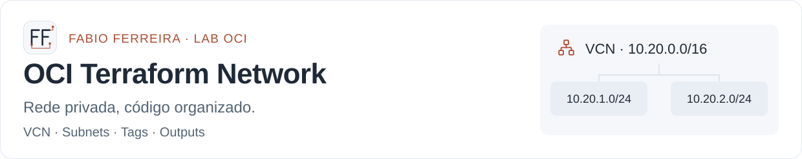
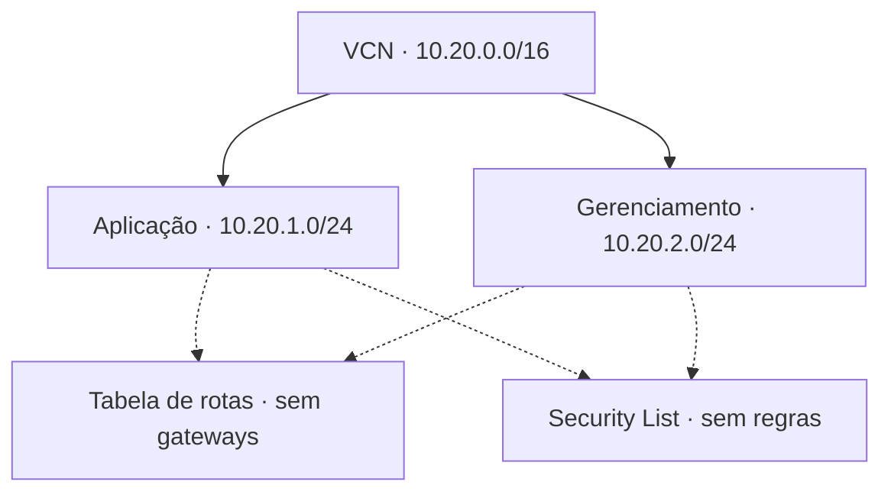

# OCI Terraform Network

<picture>
  <source media="(max-width: 600px) and (prefers-color-scheme: dark)" srcset="assets/cover-mobile-dark.svg">
  <source media="(max-width: 600px) and (prefers-color-scheme: light)" srcset="assets/cover-mobile-light.svg">
  <source media="(prefers-color-scheme: dark)" srcset="assets/cover-dark.svg">
  <source media="(prefers-color-scheme: light)" srcset="assets/cover-light.svg">
  
</picture>

[Arquitetura](#arquitetura) · [Validação local](#comecar-pela-validacao-local) · [Plano real](#preparar-um-plano-real) · [Variáveis](#variaveis-principais) · [Limites](#escopo-de-validacao)


Exemplo de infraestrutura como código para criar uma VCN e duas sub-redes privadas na Oracle Cloud Infrastructure. Preparado para o portfólio técnico de [Fabio Ferreira](https://github.com/cwbffm).

O projeto demonstra organização de Terraform, cálculo de CIDRs, tags, outputs e testes com provider simulado. A criação de recursos na OCI depende da execução explícita de `terraform apply` por quem utilizar o exemplo.

## Arquitetura



As linhas tracejadas indicam a associação das sub-redes à tabela de rotas e à Security List dedicadas; não representam fluxos de tráfego liberados.

| Componente | Configuração do exemplo |
| --- | --- |
| VCN | `10.20.0.0/16`, IPv4 privado |
| Sub-rede de aplicação | `10.20.1.0/24`, regional e sem IP público |
| Sub-rede de gerenciamento | `10.20.2.0/24`, regional e sem IP público |
| Tabela de rotas dedicada | Sem rotas para gateways |
| Security List dedicada | Sem regras de entrada ou saída |
| Tags | Projeto, ambiente, ferramenta de gestão e tags adicionais |

As sub-redes estão associadas explicitamente à tabela e à Security List dedicadas. A OCI também cria os recursos padrão da VCN; eles não são os recursos associados às sub-redes deste exemplo.

Esta é uma base de rede isolada. VMs, bancos de dados, gateways, conectividade externa e regras de comunicação entre cargas devem ser projetados separadamente antes de hospedar aplicações.

## Decisões do laboratório

| Decisão | O que o exemplo demonstra |
| --- | --- |
| Duas sub-redes privadas | Separação entre os contextos de aplicação e gerenciamento. |
| Rotas e Security List dedicadas, sem liberações | Uma base de rede isolada, com associações explícitas em vez de depender dos recursos padrão. |
| CIDRs calculados com `cidrsubnet` | Relação reproduzível entre o bloco da VCN e as sub-redes. |
| Tags centralizadas | Identificação consistente do projeto, ambiente e ferramenta de gestão. |
| Testes com provider simulado | Conferência das regras do código sem credenciais; o comportamento real na OCI exige validação separada. |

## Requisitos

- Terraform `>= 1.7.0, < 2.0.0`.
- Provider `oracle/oci` na série `7.x`.
- Compartment existente e permissões OCI para administrar os recursos de rede desse compartment.
- Para um plano real: credenciais locais configuradas em `~/.oci/config`, usando o perfil indicado em `config_file_profile`.

Os testes com provider simulado usam os arquivos locais e dispensam credenciais e acesso à sua tenancy. O `terraform init` precisa de acesso à internet para baixar o provider.

<a id="comecar-pela-validacao-local"></a>

## Começar pela validação local

Na pasta deste projeto, execute:

```bash
terraform fmt -check -recursive
terraform init -backend=false
terraform validate
terraform test
```

O workflow em `.github/workflows/terraform.yml` executa essas verificações em pushes para `docker-compose`, pull requests e execuções manuais. Ele não recebe credenciais OCI nem executa `apply`.

Este laboratório foi organizado como repositório independente a partir do [exemplo publicado no perfil de Fabio Ferreira](https://github.com/cwbffm/cwbffm/tree/8af448935358552e802feda6c6b12e4e74462626/projects/oci-terraform-network).

## Preparar um plano real

```bash
cp terraform.tfvars.example terraform.tfvars
```

Edite `terraform.tfvars` com o OCID do seu compartment de laboratório. Configure a autenticação local conforme a [documentação oficial da Oracle](https://docs.oracle.com/en-us/iaas/Content/dev/terraform/configuring.htm).

```bash
terraform init
terraform plan -out=network.tfplan
```

O plano deve indicar **cinco recursos gerenciados para criação**: uma VCN, uma tabela de rotas, uma Security List e duas sub-redes. A OCI cria os objetos padrão da VCN como parte da própria operação de criação da rede.

Após revisar o compartment, a região e as alterações planejadas, a aplicação é feita manualmente:

```bash
terraform apply network.tfplan
terraform output
```

Não inclua `terraform.tfvars`, arquivos de state, planos ou chaves privadas no Git. O `.gitignore` cobre esses arquivos; `.terraform.lock.hcl` deve ser versionado para registrar as versões efetivamente selecionadas.

<a id="variaveis-principais"></a>

## Variáveis principais

| Variável | Padrão | Finalidade |
| --- | --- | --- |
| `compartment_ocid` | Obrigatória | Compartment existente de destino |
| `region` | `sa-saopaulo-1` | Região OCI |
| `config_file_profile` | `DEFAULT` | Perfil local de autenticação |
| `project_name` | `portfolio` | Prefixo dos nomes e rótulo DNS |
| `environment` | `lab` | Ambiente e tag |
| `vcn_cidr` | `10.20.0.0/16` | Bloco privado /16; gera duas sub-redes /24 |
| `freeform_tags` | `{}` | Tags adicionais |

Os outputs apresentam o OCID da VCN, as sub-redes com seus CIDRs e os identificadores da tabela de rotas e da Security List.

## Estado e ciclo de vida

O exemplo usa state local. Em trabalho compartilhado, defina um backend remoto com controle de acesso e bloqueio compatível com sua ferramenta antes de executar alterações em equipe.

Para remover um laboratório criado por este projeto, revise primeiro o plano de destruição e confirme manualmente:

```bash
terraform plan -destroy -out=destroy.tfplan
terraform apply destroy.tfplan
```

Verifique dependências e uso dos recursos antes da remoção. Custos dependem dos serviços utilizados e da tabela comercial vigente da OCI; este exemplo não faz promessa de gratuidade.

<a id="escopo-de-validacao"></a>

## Escopo de validação

Os testes verificam CIDRs, proibição de IP público, ausência de regras e rotas externas, tags e rejeição de entradas inválidas. A execução com mocks não comprova permissões IAM, cotas, conectividade nem o comportamento de um deployment real na tenancy.

## Referências

- [Provider OCI e autenticação](https://docs.oracle.com/en-us/iaas/Content/dev/terraform/configuring.htm)
- [Recurso VCN](https://registry.terraform.io/providers/oracle/oci/latest/docs/resources/core_vcn)
- [Recurso Subnet](https://registry.terraform.io/providers/oracle/oci/latest/docs/resources/core_subnet)
- [Recursos padrão da VCN](https://docs.oracle.com/en-us/iaas/Content/ResourceManager/Tasks/terraform-manage-default-vcn-resources.htm)
- [Testes com provider simulado](https://developer.hashicorp.com/terraform/language/tests/mocking)

## Mais projetos

[Perfil de Fabio Ferreira](https://github.com/cwbffm) · [OCI Architect Studio](https://github.com/cwbffm/oci-architect-studio) · [Scripts e automações](https://github.com/cwbffm/scriptz)
